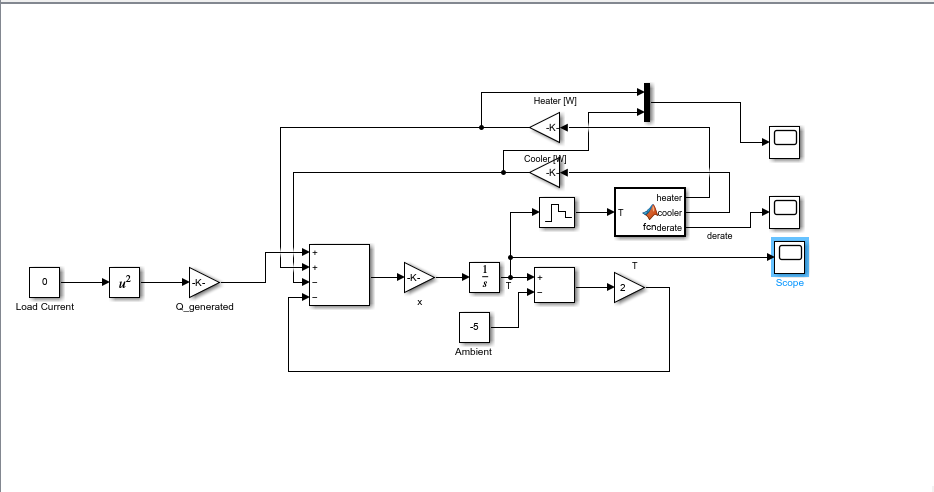
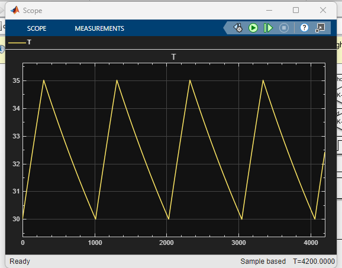
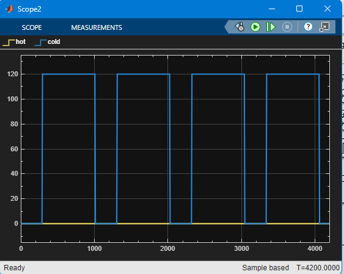
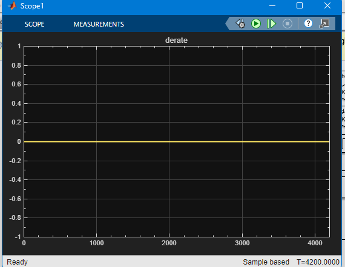
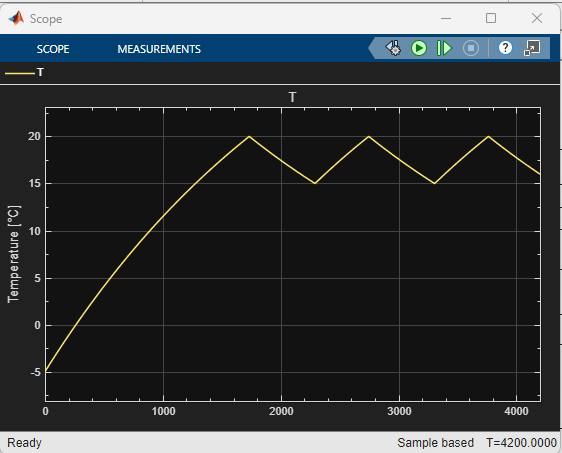
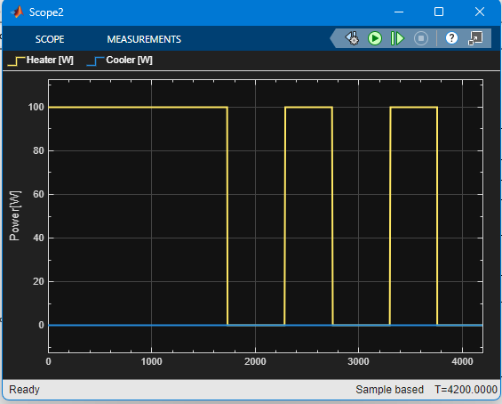
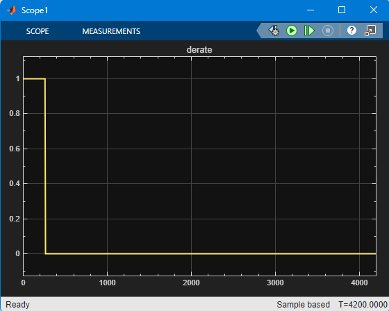

# Battery Thermal Management and Control in Simulink


A MATLAB/Simulink project that models the thermal behaviour of a battery module and implements a thermostat-style controller to maintain its temperature within a defined operating range.

The model includes active heating, active cooling, temperature monitoring and thermal protection through a current-derating request. Three operating scenarios are investigated: hot ambient conditions, cold ambient conditions and operation without active cooling.

This project is part of my battery management system (BMS) self-study series.

**Author:** Ali Sher  
**Programme:** M.Sc. Hybrid Electric Propulsion Technology  
**University:** Brandenburg University of Technology (BTU), Cottbus-Senftenberg

---

## 1. Project Overview

Battery temperature has a significant influence on performance, safety, charging capability and service life.

This project demonstrates how a thermal-management controller responds to changing ambient temperatures and battery heat generation.

The controller uses hysteresis-based switching:

- The heater activates below 15°C.
- The cooler activates above 35°C.
- A protection flag requests current derating above 55°C or below 0°C.

### Simulation Scenarios

| Scenario | Operating conditions | Main result |
|---|---|---|
| Hot day | 35°C ambient, 40 A load | Cooler maintains temperature between 30°C and 35°C |
| Cold day | -5°C ambient, no load | Heater raises temperature to 20°C and maintains a 15–20°C control band |
| No active cooling | 35°C ambient, 40 A load | Temperature reaches 55°C after approximately 34 minutes |

## 2. Thermal Model

The battery module is represented by a lumped-parameter thermal model based on an energy balance.

\[
C\frac{dT}{dt}=Q_{gen}+Q_{heater}-Q_{cooler}-\frac{T-T_{ambient}}{R}
\]

Where:

- \(C\): Thermal capacitance (J/K)
- \(T\): Battery temperature (°C)
- \(T_{ambient}\): Ambient temperature (°C)
- \(R\): Thermal resistance (K/W)
- \(Q_{gen}\): Heat generated by the battery (W)
- \(Q_{heater}\): Heater power (W)
- \(Q_{cooler}\): Cooling power (W)

### Model Parameters

| Parameter | Value |
|---|---:|
| Thermal capacitance | 5,000 J/K |
| Thermal resistance | 0.5 K/W |
| Thermal time constant | 2,500 s |
| Internal resistance | 0.05 Ω |
| Heater power | 100 W |
| Cooler power | 120 W |
| Controller sampling interval | 1 s |

Heat generation is calculated using:

\[
Q_{gen}=I^2R_{internal}
\]

At 40 A:

\[
Q_{gen}=40^2\times0.05=80\ W
\]

### Simulink Model



The model is implemented using standard Simulink blocks, including Gain, Add, Integrator, Zero-Order Hold and MATLAB Function blocks. Simscape is not required.

## 3. Control Strategy

The controller uses **bang-bang control with hysteresis**.

Hysteresis introduces separate activation and deactivation thresholds to prevent rapid switching.

| Control action | Activation | Deactivation |
|---|---|---|
| Heater | Below 15°C | Above 20°C |
| Cooler | Above 35°C | Below 30°C |
| Derating request | Above 55°C or below 0°C | Returns inside protection limits |

### Controller Implementation

```matlab
function [heater, cooler, derate] = fcn(T)

persistent h c

if isempty(h)
    h = 0;
    c = 0;
end

% Heater control
if T < 15
    h = 1;
elseif T > 20
    h = 0;
end

% Cooler control
if T > 35
    c = 1;
elseif T < 30
    c = 0;
end

% Thermal protection request
derate = double(T > 55 || T < 0);

heater = double(h);
cooler = double(c);

end
```

The heater and cooler thresholds do not overlap, preventing simultaneous heating and cooling under normal controller operation.

## 4. Simulation Results

### A. Hot Ambient Conditions

**Conditions:** 35°C ambient temperature and 40 A battery current.

The battery generates 80 W of heat. When its temperature exceeds 35°C, the cooler activates and provides 120 W of cooling power.

The temperature cycles between approximately 30°C and 35°C.

- Heating period: approximately 294 s.
- Cooling period: approximately 719 s.
- Cooling duty cycle: approximately 71%.
- Average cooling power: approximately 85 W.
- Thermal protection flag: remains inactive.

**Battery temperature**



**Heater and cooler power**



**Thermal protection signal**



### B. Cold Ambient Conditions

**Conditions:** -5°C ambient temperature and no battery load.

The heater activates immediately because the initial battery temperature is below 15°C.

The battery reaches 20°C after approximately 1,730 seconds. Afterwards, the controller maintains the temperature between 15°C and 20°C.

- Initial heating period: approximately 1,730 s.
- Heater activation period during cycling: approximately 455 s.
- Heater deactivation period during cycling: approximately 560 s.
- Average heater power during cycling: approximately 45 W.
- Thermal protection flag: active until the battery temperature rises above 0°C.

**Battery temperature**



**Heater and cooler power**



**Thermal protection signal**



### C. Operation Without Active Cooling

The cooler is disabled by setting its gain to zero.

Under the same hot-day conditions, the battery temperature increases because the generated heat is not actively removed.

The model predicts that the battery reaches 55°C after approximately 2,030 seconds (34 minutes). The thermal protection flag then activates.

The theoretical steady-state temperature of this simplified model is 75°C.

## 5. Analytical Verification

The simulation results can be checked using the first-order thermal response:

\[
T(t)=T_{\infty}+(T_0-T_{\infty})e^{-t/\tau}
\]

Where:

\[
\tau=RC=0.5\times5000=2500\ s
\]

The calculated results are:

| Scenario | Analytical result | Simulation result |
|---|---:|---:|
| Cold day: time to reach 20°C | 1,733 s | Approximately 1,730 s |
| Hot day: heating from 30°C to 35°C | 294 s | Approximately 294 s |
| Hot day: cooling from 35°C to 30°C | 719 s | Approximately 719 s |
| No cooling: time to reach 55°C | 2,027 s | Approximately 2,030 s |

The close agreement demonstrates that the Simulink model follows the expected first-order thermal response.

## 6. Engineering Observations

1. **Hysteresis prevents rapid switching:** Separate activation and deactivation thresholds improve controller stability.
2. **Heat generation increases with current squared:** Doubling the current produces four times the resistive heat at constant resistance.
3. **Thermal response is relatively slow:** The 2,500-second time constant means temperature changes gradually.
4. **Thermal protection is important:** A derating request can help prevent operation outside the defined temperature limits.
5. **Thermal management consumes energy:** Heating and cooling require additional electrical power, which can affect vehicle efficiency and driving range.

## 7. How to Run the Model

1. Open MATLAB.
2. Open `day16_thermal_control.slx` in Simulink.
3. Set the simulation stop time to 4200 seconds.
4. Change the following parameters to investigate different scenarios.

| Parameter | Hot day | Cold day | No cooling |
|---|---:|---:|---:|
| Load current (A) | 40 | 0 | 40 |
| Ambient temperature (°C) | 35 | -5 | 35 |
| Initial temperature (°C) | 30 | -5 | 30 |
| Cooler gain (W) | 120 | 120 | 0 |

Run the simulation and compare the temperature, actuator power and thermal protection signals.

## 8. Model Limitations

This project is a simplified thermal-control study, not a validated battery-pack thermal model.

- The battery is represented by a single lumped thermal mass.
- Thermal capacitance and resistance are assumed rather than fitted to experimental data.
- Internal resistance is constant and does not vary with temperature or state of charge.
- Heater and cooler powers are idealised as constant.
- Ambient temperature is assumed to remain constant.
- Temperature differences between individual cells are not modelled.
- The derating signal is a protection request; it does not directly control battery current.

## 9. Future Improvements

- [ ] Couple the thermal model with a Simscape Battery model.
- [ ] Use temperature-dependent internal resistance and heat generation.
- [ ] Implement PI-based temperature control.
- [ ] Investigate battery preheating before charging or driving.
- [ ] Model temperature gradients between individual cells.
- [ ] Connect thermal protection to an actual current-limiting strategy.

## 10. Related Battery Management Projects

| Project | Main topic |
|---|---|
| [UKF vs EKF SOC Estimation](https://github.com/alisherbtu/ukf-vs-ekf-soc-estimation) | State-of-charge estimation |
| [Coulomb Counting SOC Estimation](https://github.com/alisherbtu/coulomb-counting-soc-estimation) | SOC estimation errors and drift |
| [Active Cell Balancing](https://github.com/alisherbtu/active-cell-balancing) | Energy transfer between cells |
| [Passive Cell Balancing](https://github.com/alisherbtu/passive-cell-balancing) | Resistor-based cell balancing |
| [Battery Pack Grid](https://github.com/alisherbtu/battery-pack-grid) | Grid-connected battery pack model |

---

**Note:** This is an educational self-study project. All reported results are obtained from the described Simulink model and analytical calculations, not experimental battery measurements.
